# MiniModule - Creating a Module Project

## Synopsis

Shows how to use the MiniModule template for a new PowerShell project, in a detailed step-by-step guide.

## Guidance

1. Create a local Repository Example `c:\PSScripts\Repository`
2. Install GitHub Desktop from here: [https://desktop.github.com/](https://desktop.github.com/)
3. In GitHub Desktop click File | Create a new repository

**IMPORTANT:** Directory must not already exist! If you have pre-created a directory for your code GitHub will throw an error.

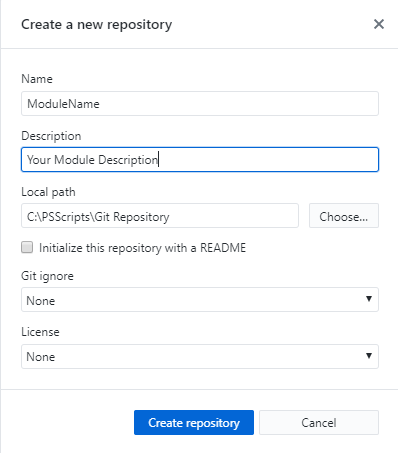

Once GitHub creates your new module directory this is what it will look like.

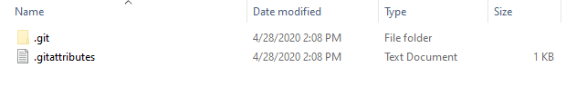

4. Open a new PS window
5. Change directory to that folder `cd "C:\PSScripts\Git Repository\YourModuleName"`
6. Run `invoke-PSMDTemplate -TemplateName "MiniModule" -NoFolder`

    > NOTE: Using the -nofolder will skip the folder creation because the folder has already been created by GitHub Desktop
7. Enter value for parameter 'GithubAccount': `YourGithubUserName`
8. Enter value for parameter 'name': `YourModuleName`
9. Enter value for parameter 'description': `This is a test PowerShell module`

Below is the output in the directory you will see after you invoke the creation of your new template. This template will be used for submitting your code to GitHub for validation testing. You will want to do this before real work release of your code.

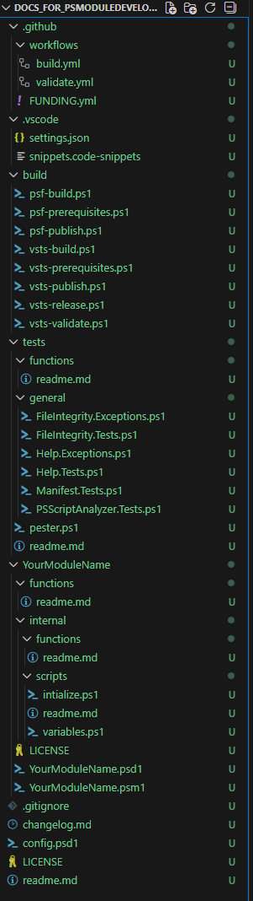

### Project Structure Overview and places you should properly take a look at.

```
YourModuleName/
├── .github/
│   ├── workflows/
├── .vscode/
├── build/
├── YourModuleName/ <-- Code for your module goes into this folder
│   ├── YourModuleName.psd1 <-- This is the configuration for your module visit the official docs to get a better understanding "https://learn.microsoft.com/en-us/powershell/module/microsoft.powershell.core/about/about_module_manifests?view=powershell-7.5" NOTE that you do not have to do anything to this file but you might want to know about it.
│   ├── functions/ <-- Public facing commands that a user should be able to use
│   └── internal/
│       ├── functions/ <-- Internal commands that your module can utilize
│       └── scripts/ <-- Variables and code that need to be run when importing your module
├── tests/
│   ├── functions/
│   └── general/
├── changelog.md <-- Specify your awesome code updates here
├── config.psd1 <-- Update the options to reflect how it should build your module
├── LICENSE
└── README.md <-- Read the README.md it has usefull docs that helps you get started and also remember this is the front page in your github repository so this is the first thing anyone visiting will see.
```

1. In explorer go up one directory to your Repository and right click on your Test module folder and open in your programming application (VS Code, Visual Studio, etc.)
	
    > NOTE: Once your code is opened in your favorite developmental tool you can develop away until you have all of your code the way you like it. Since GitHub Desktop is already connected to your local code path all new code changes will be detected.

2.  Once you are finished with your code you can save your code changes.
3.  Commit your changes with your comments.
4.  Lastly publish your code to your GitHub repository.

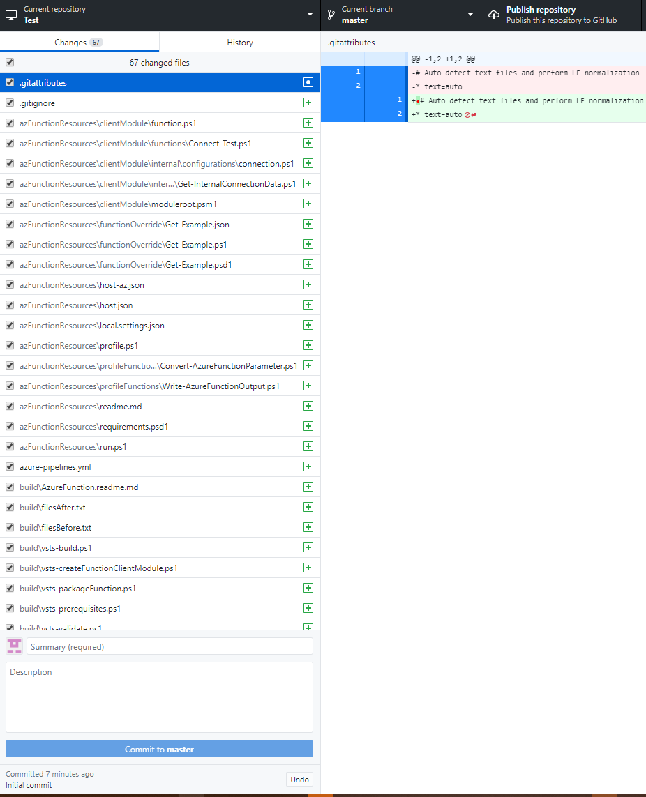


5. When you publish the code to your Github repository directly without a pull request it will run the action `.github/workflows/build.yml` and it will fail

    NOTE: Remember to add some comment based help to your function otherwise some pester test will fail. You can read some documentation on it here: https://learn.microsoft.com/en-us/powershell/module/microsoft.powershell.core/about/about_comment_based_help?view=powershell-7.5

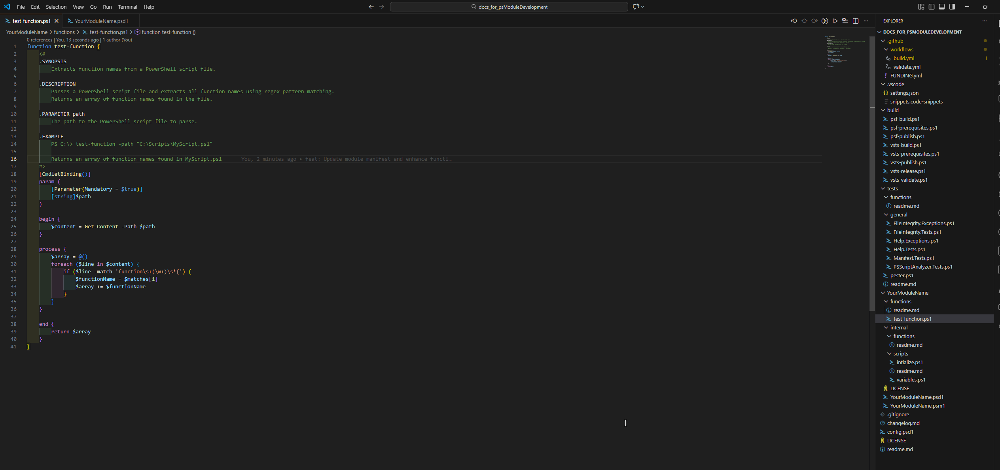

-   The reason for the failure is that we have not added our key for the PowerShell Gallery to GitHub

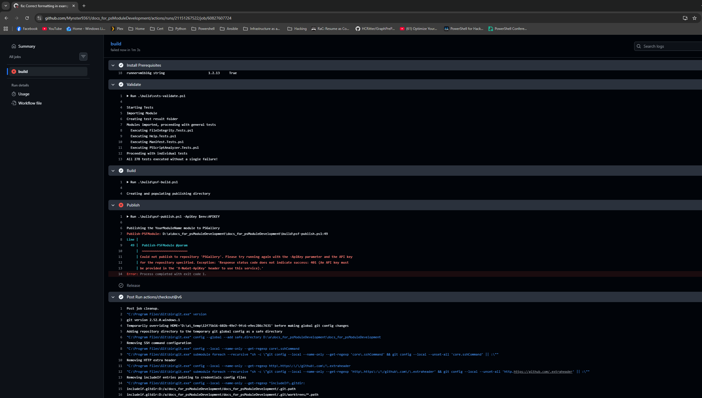

6. Create an account on PowerShell Gallery https://www.powershellgallery.com/ and login.
-   Once logged in click your username (top right) and click API Keys
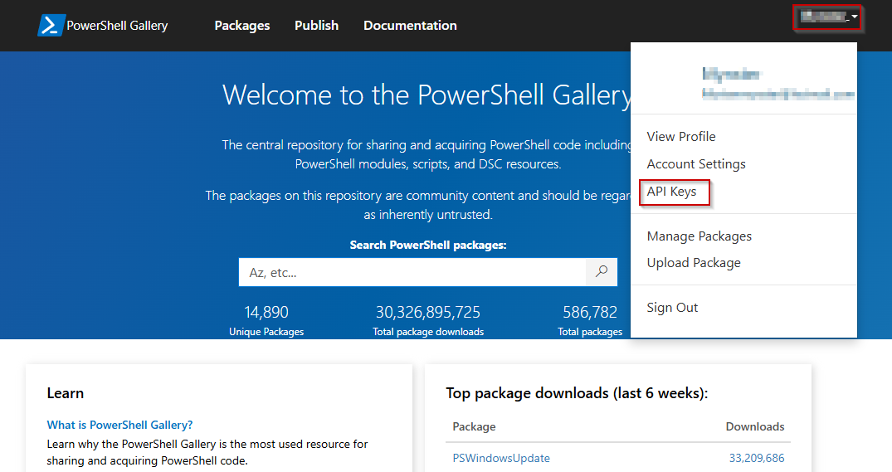
-   Click `+ Create` and fill in information as needed
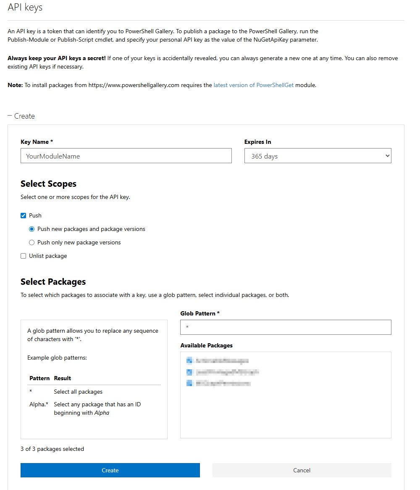
-   Copy the API key
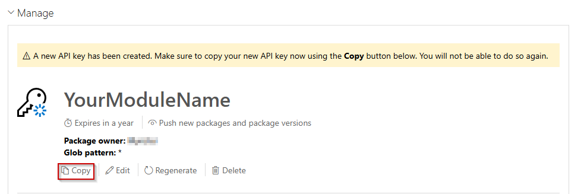
-   Go to GitHub and click on `Settings` -> `Secrets and variables` -> `Actions` -> `New repository secret`
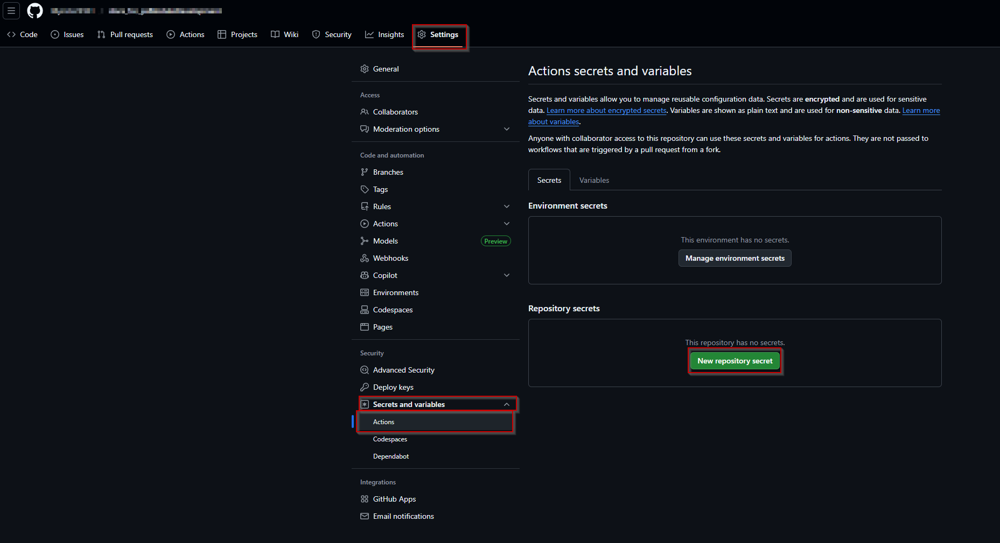
-   Name the secret `ApiKey` and paste the secret from PowerShell Gallery and click `Add secret`
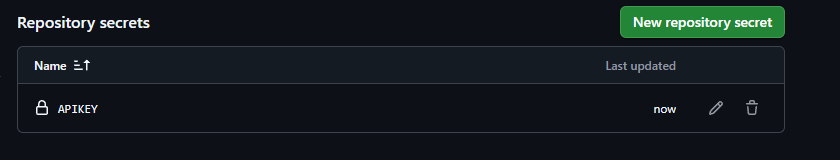
-   Once this is done you can go to the `Actions tab` Open the failed run and click `Re-run all jobs` and click `Re-run jobs` it should publish your module to PowerShell Gallery
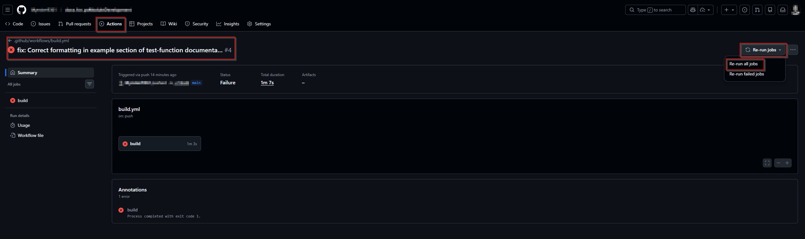

And with that **Congratulations you released a module to the gallery**
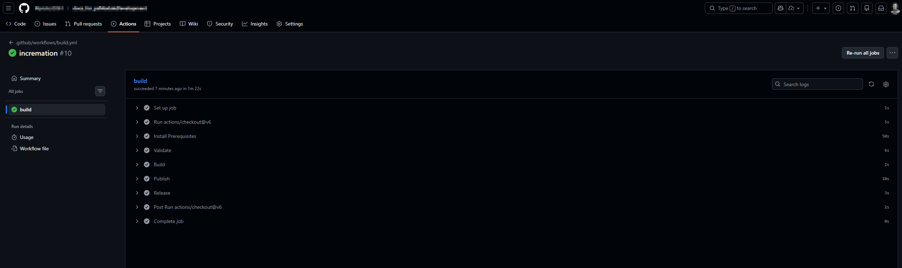
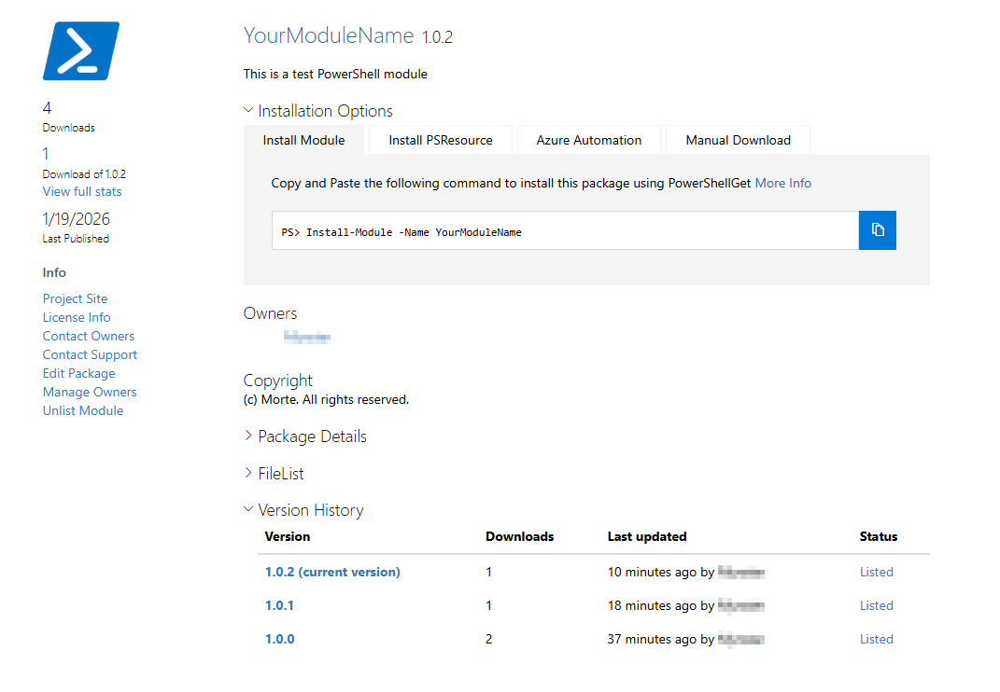
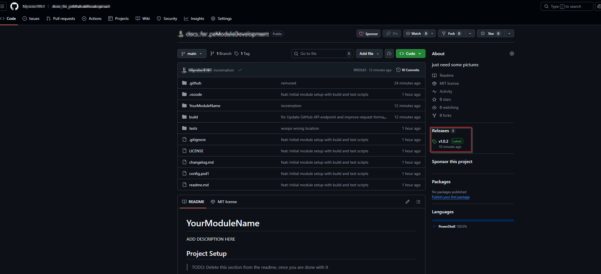

